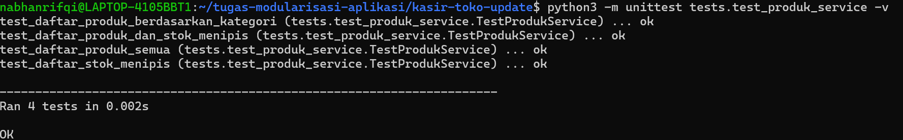
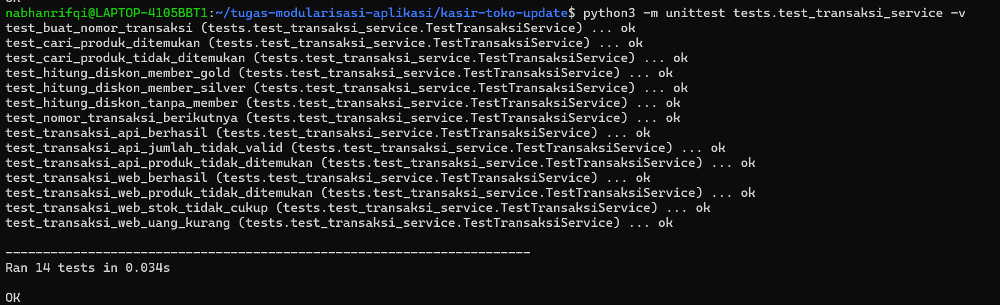
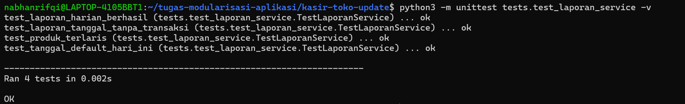
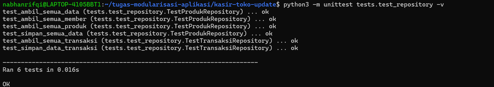
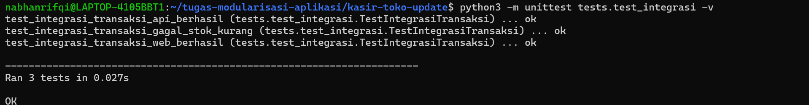
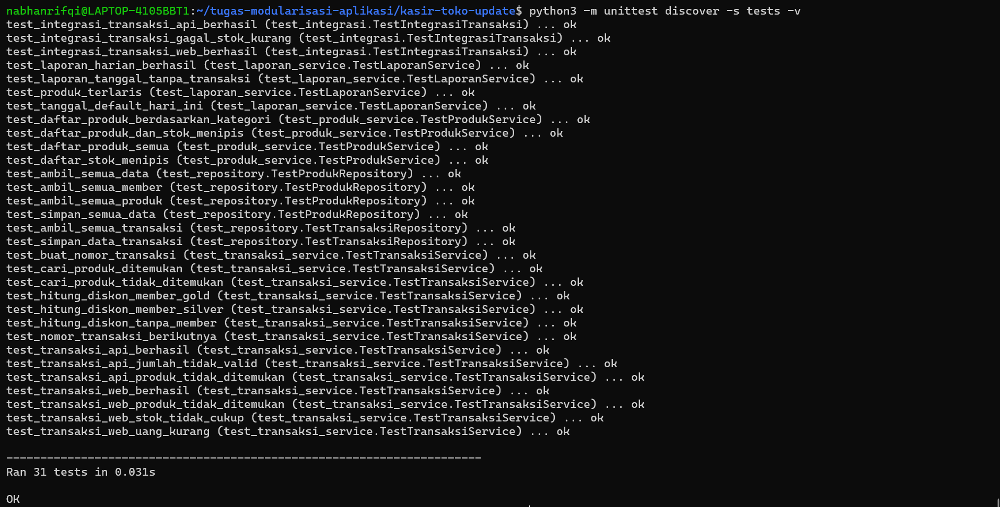
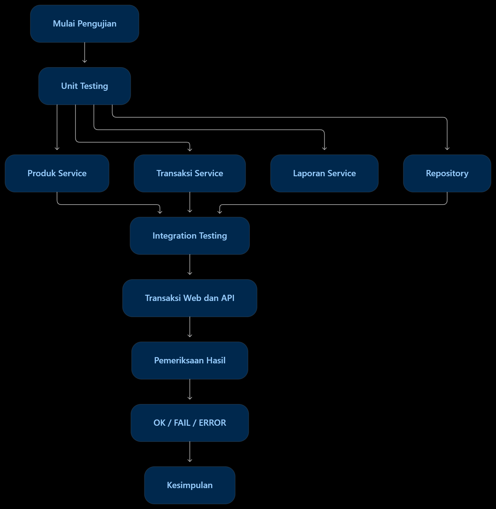
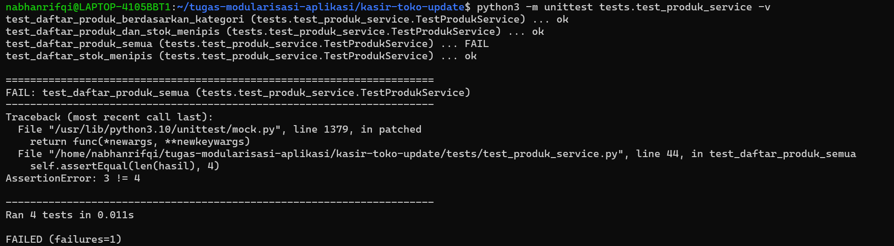

## Dokumentasi Pengujian

Pengujian aplikasi Kasir Toko dilakukan menggunakan
library unittest pada Python. Pengujian terdiri dari
Unit Testing dan Integration Testing.

### 1. Unit Testing

#### A. Produk Service

Pengujian dilakukan untuk memastikan fungsi pengelolaan
produk berjalan dengan baik, meliputi daftar produk,
filter kategori, dan pemeriksaan stok menipis.



#### B. Transaksi Service

Pengujian dilakukan terhadap proses pencarian produk,
perhitungan diskon, pembuatan nomor transaksi,
validasi pembayaran, dan pemrosesan transaksi web maupun API.



#### C. Laporan Service

Pengujian dilakukan untuk memastikan laporan harian,
omzet, jumlah transaksi, dan produk terlaris
dapat dihitung dengan benar.



#### D. Repository

Pengujian dilakukan terhadap fungsi pengambilan
dan penyimpanan data produk, member, dan transaksi
pada file JSON.



### 2. Integration Testing

Pengujian integrasi dilakukan untuk memastikan
modul service dan repository dapat bekerja sama
dalam proses transaksi web dan API, termasuk
penanganan transaksi yang gagal karena stok kurang.



### 3. Hasil Pengujian Keseluruhan

Seluruh pengujian dijalankan menggunakan perintah:

```bash
python3 -m unittest discover -s tests -v
```

Hasil pengujian menunjukkan bahwa 31 test berhasil
dijalankan tanpa kegagalan.



### 4. diagram testing



### 5. contoh pengujian gagal

Pengujian gagal disebabkan oleh ketidaksesuaian antara jumlah produk aktual dengan jumlah produk yang diharapkan. Data pengujian menyediakan tiga produk, sedangkan nilai ekspektasi sengaja diubah menjadi empat. Akibatnya, pengujian menghasilkan status FAIL. Skenario ini digunakan untuk membuktikan bahwa unit testing mampu mendeteksi kesalahan atau ketidaksesuaian hasil.

 