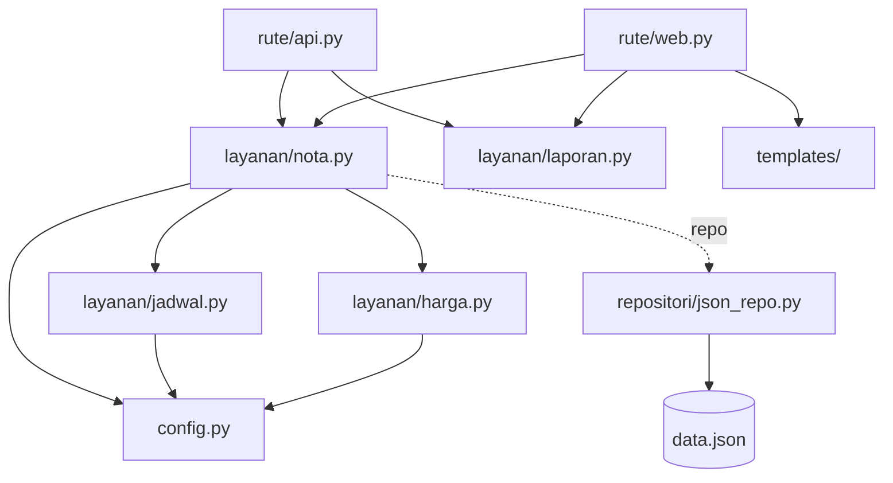

# Contoh: Laundry Kiloan — Sebelum & Sesudah Modularisasi

Contoh ini **bukan salah satu aplikasi tugas**. Isinya satu aplikasi dalam dua versi dengan **perilaku yang sama persis**:

| Folder | Isi | Port |
|--------|-----|------|
| [`sebelum/`](sebelum/) | Versi **monolitik**: semua kode di satu `app.py` (226 baris) | 5008 |
| [`sesudah/`](sesudah/) | Versi **modular**: 15 file Python kecil + 2 template, masing-masing satu tanggung jawab | 5009 |

Bandingkan keduanya untuk melihat **cara** memecah logika, lalu terapkan pada aplikasi tugas Anda.

```bash
cd contoh-laundry-kiloan/sebelum && docker compose up --build   # http://localhost:5008
cd contoh-laundry-kiloan/sesudah && docker compose up --build   # http://localhost:5009
```

---

## Aturan Bisnis

1. Tarif per kg: **cuci kering Rp 7.000**, **cuci setrika Rp 9.000**, **setrika Rp 6.000**
2. Berat **di bawah 3 kg tetap ditagih 3 kg**; berat maksimal 50 kg per nota
3. **Express**: tambah **50%** dari harga dasar, selesai 1 hari (reguler 2 hari)
4. **Member** (dicari dari nomor HP): diskon **10%** dari (harga dasar + biaya express)
5. Validasi: layanan dikenal, berat 0–50 kg, nama wajib, HP berpola `08xxxxxxxxxx`
6. Bila estimasi selesai jatuh pada **hari Minggu**, digeser ke Senin
7. Nomor nota `LDY-YYMMDD-NN`, urut per hari
8. Status hanya maju satu langkah: **diterima → dicuci → siap → diambil**
9. **Biaya simpan Rp 2.000/hari** bila diambil lebih dari 7 hari setelah estimasi selesai
10. Laporan harian: jumlah nota, total kg, pendapatan, jumlah nota per layanan

---

## Masalah di Versi `sebelum/`

| Masalah | Bukti di `sebelum/app.py` |
|---------|---------------------------|
| **Logika disalin** web ↔ API | Validasi (baris 47–54 dan 153–160), hitung harga (56–68 dan 161–170), estimasi (70–72 dan 172–174), biaya simpan (99–101 dan 202–204) |
| **Baca/tulis JSON diulang** | `json.load` 7 kali, `json.dump` 4 kali |
| **Magic number** | `7000`, `9000`, `6000`, `3`, `50`, `10`, `6`, `7`, `2000` tersebar di dalam route |
| **HTML di dalam Python** | Baris tabel dirangkai dengan `+` (baris 18–21), template sebagai string (baris 23, 125) |
| **Dua gaya untuk aturan yang sama** | Tarif: `if/elif` di web (56–60) vs dict di API (161); berat minimal: `if/else` (61) vs `max()` (162) |

---

## Struktur Versi `sesudah/`

```
sesudah/
├── app.py              # create_app(): merakit blueprint, repositori, filter rupiah
├── config.py           # SEMUA angka aturan bisnis (tarif, express, diskon, hari tutup, biaya simpan)
├── repositori/
│   └── json_repo.py    # RepositoriJson: muat() & simpan(); satu-satunya yang menyentuh data.json
├── layanan/            # aturan bisnis, TANPA Flask
│   ├── galat.py        # GalatValidasi (400), TidakDitemukan (404)
│   ├── harga.py        # berat_ditagih, harga_dasar, biaya_express, diskon_member, rincian_harga
│   ├── jadwal.py       # estimasi_selesai, biaya_simpan
│   ├── nota.py         # validasi_pesanan, adalah_member, nomor_nota, buat_nota, status_berikutnya, lanjutkan_status
│   └── laporan.py      # laporan_harian
├── rute/
│   ├── web.py          # form HTML → panggil layanan → redirect/template
│   └── api.py          # JSON → panggil layanan yang SAMA → jsonify; galat → status HTTP
├── templates/          # index.html, laporan.html
└── utils/format.py     # format_rupiah
```



---

## Peta Perubahan

| Blok di `sebelum/app.py` | Fungsi baru | Modul | Alasan |
|--------------------------|-------------|-------|--------|
| `open` + `json.load` / `json.dump` (11 tempat) | `RepositoriJson.muat()`, `.simpan()` | `repositori/json_repo.py` | Information hiding: hanya satu modul yang tahu format penyimpanan |
| Cek layanan, berat, nama, HP (47–54, 153–160) | `validasi_pesanan(nama, hp, layanan, berat)` | `layanan/nota.py` | Satu aturan validasi untuk web dan API |
| Pilih tarif (56–60, 161) | `TARIF_PER_KG[layanan]` | `config.py` | Data, bukan logika; menambah layanan cukup menambah satu baris (OCP) |
| Berat minimal 3 kg (61, 162) | `berat_ditagih(berat)` | `layanan/harga.py` | Satu aturan, satu fungsi |
| Biaya express (63, 164–166) | `biaya_express(harga, express)` | `layanan/harga.py` | |
| Cek member (64–67, 167) | `adalah_member(pelanggan, hp)` | `layanan/nota.py` | |
| Diskon member (68, 168–170) | `diskon_member(subtotal, member)` | `layanan/harga.py` | |
| Rangkaian harga dasar → total | `rincian_harga(layanan, berat, express, member)` | `layanan/harga.py` | Menggabungkan fungsi-fungsi kecil di atas |
| Estimasi + geser Minggu (70–72, 172–174) | `estimasi_selesai(tgl, express)` | `layanan/jadwal.py` | Tanggal menjadi parameter, bukan `date.today()` di dalam logika |
| Nomor nota (73–74, 175) | `nomor_nota(tgl, daftar_nota)` | `layanan/nota.py` | |
| Urutan status (90–97, 193–198) | `status_berikutnya(status)` | `layanan/nota.py` | |
| Biaya simpan (99–101, 202–204) | `biaya_simpan(estimasi, tgl_diambil)` | `layanan/jadwal.py` | |
| Hitung laporan (115–124, 216–221) | `laporan_harian(daftar_nota, tanggal)` | `layanan/laporan.py` | |
| Format rupiah (20, 128) | `format_rupiah(nilai)` + filter Jinja `rupiah` | `utils/format.py` | |
| HTML string (18–31, 125–127) | `index.html`, `laporan.html` | `templates/` | Tampilan terpisah dari logika |

---

## Satu Contoh Lengkap: Biaya Simpan

**Sebelum.** Ditulis dua kali dengan gaya berbeda, langsung di dalam route:

```python
# route web /nota/<no>/status (baris 99–101)
lewat = (hari_ini - datetime.date.fromisoformat(n["estimasi_selesai"])).days - 7
n["tgl_diambil"] = hari_ini.isoformat()
n["biaya_simpan"] = lewat * 2000 if lewat > 0 else 0

# route API /api/nota/<no>/status (baris 202–204)
lewat = (tgl - datetime.date.fromisoformat(nota["estimasi_selesai"])).days - 7
nota["tgl_diambil"] = tgl.isoformat()
nota["biaya_simpan"] = max(lewat, 0) * 2000
```

**Sesudah.** Satu fungsi kecil dengan angka dari `config.py`:

```python
# layanan/jadwal.py
def biaya_simpan(estimasi: date, tgl_diambil: date) -> int:
    """Gratis sampai MASA_SIMPAN_GRATIS_HARI setelah estimasi selesai; lewat dari itu dikenai biaya per hari."""
    lewat = (tgl_diambil - estimasi).days - MASA_SIMPAN_GRATIS_HARI
    return max(lewat, 0) * BIAYA_SIMPAN_PER_HARI
```

Dipanggil oleh **satu** fungsi alur, yang dipakai bersama oleh web dan API:

```python
# layanan/nota.py
def lanjutkan_status(repo, no, tgl):
    ...
    nota["status"] = status_berikutnya(nota["status"])
    if nota["status"] == "diambil":
        nota["tgl_diambil"] = tgl.isoformat()
        nota["biaya_simpan"] = biaya_simpan(date.fromisoformat(nota["estimasi_selesai"]), tgl)
    repo.simpan(data)
    return nota
```

```python
# rute/web.py — hanya urusan HTTP
n = lanjutkan_status(_repo(), no, date.today())

# rute/api.py — hanya urusan HTTP
return jsonify(lanjutkan_status(_repo(), no, _tanggal(b.get("tanggal"))))
```

Bila masa simpan gratis berubah dari 7 menjadi 14 hari, **sebelum** perlu mengubah 2 tempat di dalam route, sedangkan **sesudah** cukup mengubah 1 baris di `config.py`.

---

## Cek Cepat: Hasilnya Sama

Jalankan pada port 5008 (sebelum) dan 5009 (sesudah); hasilnya harus identik.

```bash
curl -s 'localhost:5008/api/laporan?tanggal=2026-10-19'
```
Hasil: `jumlah_nota` 2, `total_kg` 6.5, `pendapatan` 67950

```bash
curl -s -X POST localhost:5008/api/nota -H 'Content-Type: application/json' \
  -d '{"nama":"Eka","hp":"081234567890","layanan":"cuci_setrika","berat":4.5,"express":true,"tanggal":"2026-10-23"}'
```
Hasil: `harga_dasar` 40500, `biaya_express` 20250, `diskon` 6075 (member), `total` 54675, `estimasi_selesai` 2026-10-24

```bash
curl -s -X POST localhost:5008/api/nota/LDY-261019-01/status -H 'Content-Type: application/json' -d '{"tanggal":"2026-10-29"}'
```
Hasil: `status` diambil, `biaya_simpan` 2000 (8 hari setelah estimasi 21 Oktober)

---

## Cocokkan dengan Kriteria Minimal Tugas

| Kriteria | Di versi `sesudah/` |
|----------|---------------------|
| ≥ 8 fungsi layanan | 14 fungsi di `harga.py`, `jadwal.py`, `nota.py`, `laporan.py` |
| JSON hanya di repositori | `json.load`/`json.dump` hanya di `repositori/json_repo.py` |
| Tidak ada HTML di `.py` | HTML hanya di `templates/` |
| Web & API memanggil fungsi yang sama | Keduanya memanggil `buat_nota`, `lanjutkan_status`, `laporan_harian` |
| Tanpa magic number | Semua angka aturan di `config.py` |
| `layanan/` tanpa Flask | Tidak ada `import flask` di `layanan/` |
| Perilaku sama | Cek Cepat di atas memberi hasil identik |
